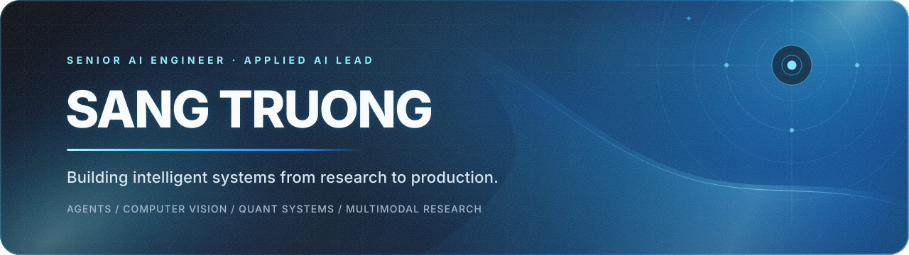

  

  
<strong>Senior AI Engineer · Applied AI Systems</strong> Head of Artificial Intelligence at EPIC TECHNOLOGY

  <a href="https://sangtruong.me/"><b>Portfolio</b></a>
  &nbsp;·&nbsp;
  <a href="https://linkedin.com/in/tqsang"><b>LinkedIn</b></a>
  &nbsp;·&nbsp;
  <a href="https://scholar.google.com/citations?user=JG2yzhgAAAAJ"><b>Google Scholar</b></a>
  &nbsp;·&nbsp;
  <a href="mailto:tqsang97@gmail.com"><b>Email</b></a>

## What I build

I lead AI engineering at **EPIC TECHNOLOGY** and remain hands-on with architecture, implementation, testing and production delivery. I lead five direct reports across AI engineering, backend and QA while building the AI and backend paths of systems used in lending, healthcare, video intelligence, factory inspection and education.

My work spans **LLM and agent systems, computer vision and edge AI, quantitative ML, speech, data platforms and distributed backends**. The hard problems are often outside the model: information available at decision time, source identity, clinical authority, state consistency, failure recovery and whether an evaluation result survives real operation.

Before EPIC, I designed and implemented the core LangGraph orchestration for an enterprise assistant at FPT Software. My research background includes multimodal video understanding, industrial vision and biomedical machine learning.

## Selected systems

**Credit Risk ML & Decision Infrastructure · EPIC TECHNOLOGY**

Led architecture and hands-on engineering for an Australian consumer-lending risk workflow: governed Open Banking data, point-in-time Spark/Iceberg features, XGBoost/LightGBM models, SageMaker inference and staged production rollout. Worked on training-data leakage and offline/online feature consistency. The lender's identity remains confidential.

[Credit-risk engineering case study](https://sangtruong.me/work/credit-risk/)

**Clinical AI & Decision Support · EPIC TECHNOLOGY**

Designed and delivered clinician-facing AI for a traditional medicine hospital, combining prescription extraction, interaction and dose checks, governed retrieval, traceable answers and deterministic clinical rules. Physicians retain decision authority.

[Clinical AI case study](https://sangtruong.me/work/yhct/)

**Production Multi-Camera Video Intelligence · EPIC TECHNOLOGY**

Architected and implemented most of the system's software: heterogeneous camera ingest, source identity/freshness, YOLO-based perception, license-plate recognition, temporal events, evidence capture, monitoring and bounded recovery. Physical camera installation was team-owned.

[Video intelligence case study](https://sangtruong.me/work/epic-video/)

**Manufacturing Fastener Visual Inspection · EPIC TECHNOLOGY**

Deployed YOLO-based incorrect/mismatched fastener inspection on one real manufacturing line. My work covered data preparation, camera/ROI calibration, inspection logic and recovery from false rejects after camera changes.

**Internal AI Meeting Tool · EPIC TECHNOLOGY**

Built an internal desktop assistant for international product sales and technical presales. It combines live meeting speech, selected project/reference retrieval and on-demand technical answers to support colleagues without deep product expertise, then prepares discovery notes, CRM-ready summaries and customer follow-up drafts.

[Sales and technical presales case study](https://sangtruong.me/work/internal-ai-meeting/)

**Enterprise Conversational AI · FPT Software**

Designed and implemented the core LangGraph AI4U orchestration: conversation state, routing, tenant-aware retrieval, tool boundaries, retries and output safeguards. The surrounding product platform and AKS operations were team-owned.

[Enterprise agents case study](https://sangtruong.me/work/enterprise-agents/)

**Curren · Independent Side Project, Solo Builder**

Built quantitative research and signal infrastructure around point-in-time evidence, reproducible evaluation, risk-gated lifecycle state and a sanitized read-only verification surface. Independent project since June 2026; no implied guaranteed returns or validated profitable alpha.

[Curren case study](https://sangtruong.me/work/curren/) · [Public code](https://github.com/sangtrx/curren)

## Technical focus

| Domain | Engineering depth |
|---|---|
| **AI agents & backends** | Python, FastAPI, LangGraph/LangChain, RAG, PostgreSQL, Qdrant, Redis, Celery/RabbitMQ, tool and state contracts |
| **Computer vision & edge** | PyTorch, TensorFlow, OpenCV, YOLO, ALPR, tracking, RTSP/HLS, FFmpeg, ONNX, TensorRT/CUDA, Jetson |
| **Data, risk & quantitative ML** | Python/Rust, Spark/Iceberg, SageMaker, Arrow/Parquet, Polars/DuckDB, LightGBM/XGBoost, causal/time-aware evaluation |
| **Product & operations** | TypeScript/React, Docker, Linux, cloud/on-prem delivery, observability, recovery, deployment and acceptance |

## Research and education

- **M.S. Computer Engineering, University of Arkansas**, GPA **4.0/4.0**, awarded December 2023.
- **B.Eng. Automation and Control Engineering, International University - VNU HCMC**, ranked **2nd in cohort (top 1%)**, GPA 3.50/4.00.
- **Eight peer-reviewed publications** across venues including **IJCV, AAAI (2023 Oral), IEEE JBHI, Poultry Science, IEEE Access, ICIP, BMVC and IEEE BHI**. My work includes temporal/video-language learning, medical time-series ML and industrial computer vision.
- In the CarcassFormer collaboration, I worked substantially on dataset preparation, annotation workflows, training, evaluation and scientific writing.

[Research record](https://scholar.google.com/citations?user=JG2yzhgAAAAJ) · [Full career and project portfolio](https://sangtruong.me/)

---

Ho Chi Minh City, Vietnam · Vietnamese / English · [tqsang97@gmail.com](mailto:tqsang97@gmail.com)
